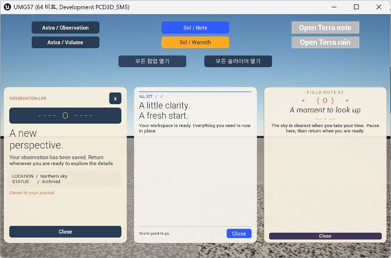
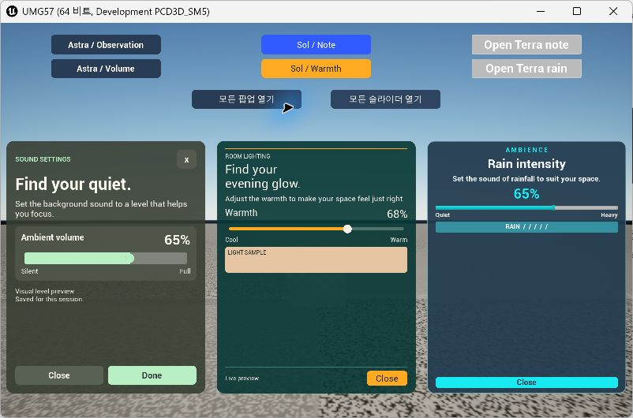
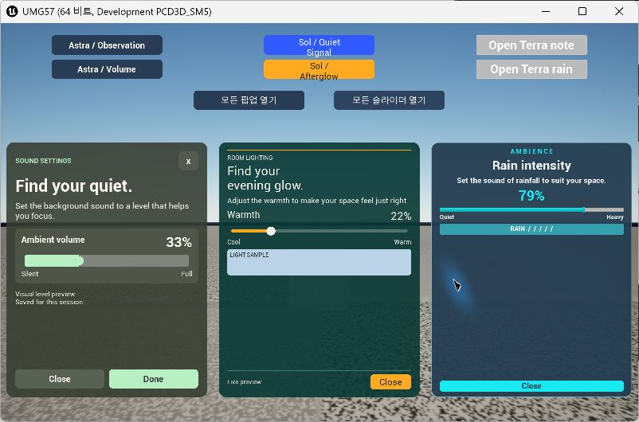
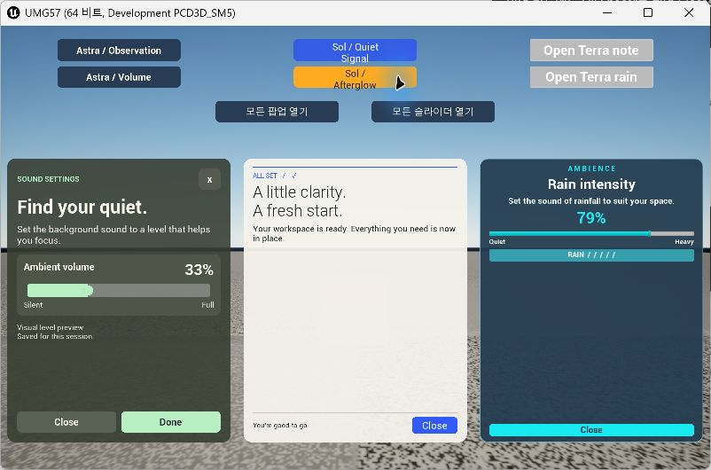

# 시안 기반 팝업 6종 구현 비교 평가

평가일: 2026-11-08 (KST). UE 5.7.4 / Win64 Development / main. 기존 시안 6장을 실제 UMG 팝업으로 구현했다. 각 모델은 자기 대화에서 기본형과 수평 슬라이더형을 작성했고, Astra 마스터가 통합·공통 테스트·실행 QA·보고서를 담당했다.

**기능 요구는 세 모델 모두 충족했다.** 기본형은 Astra가 정보 구획을 가장 많이 옮겼고, 슬라이더형은 Sol이 값 변화와 시각적 효과의 관계를 가장 명확히 보여준다. Terra는 구조가 단순하지만 원본의 분위기와 장식 재현은 가장 축약됐다. 이는 이번 결과물에 대한 정성 평가이며 모델 일반 성능 순위가 아니다.

## 평가 조건과 범위

| 담당 | 실제 모델 / reasoning | 기본형 | 슬라이더형 |
|---|---|---|---|
| Astra | GPT-6 Astra / Medium | Observation Journal | Ambient Volume |
| Sol | GPT-6.1 Sol / Medium | Quiet Signal | Afterglow |
| Terra | GPT-6.1 Terra / Medium | Quiet Observatory | Rain Room |

원본은 [디자인 시안 비교 문서](popup-design-concepts-comparison.md)에 보관했다. 이미지 생성 엔진과 시안 프롬프트 작성 모델은 구별해야 한다. 이번 문서는 생성 이미지 자체가 아니라 각 모델이 작성한 C++·WBP와 실제 실행 화면을 평가한다.

동일 화면의 왼쪽 Astra, 가운데 Sol, 오른쪽 Terra에 카드가 열린다. 각 열은 기본형과 슬라이더형 중 하나만 표시한다. 모델별 버튼 6개와 ‘모든 팝업 열기’, ‘모든 슬라이더 열기’를 제공한다. 팝업 외부 클릭을 가로막는 전체 화면 배경이나 모달 입력 모드를 사용하지 않는다.

사진 한 장을 위젯으로 덮는 방식은 사용하지 않았다. 제목·본문·버튼·USlider·ProgressBar·미리보기는 실제 UMG 요소이며, 트리는 에디터 생성기로 WBP에 저장했다. 런타임 클래스는 값과 이벤트만 처리한다.

## 실제 실행 캡처

1600×1000으로 실행한 게임 창을 Windows 캡처 도구가 802×530 이미지로 반환했다. 아래 파일은 실제 창 캡처이며 생성 시안이나 합성 이미지가 아니다.

### 기본형 3종

- **Astra:** 네이비 장식 영역, 관측 로그, 제목·본문, 위치·상태 정보, 저장 안내와 닫기 버튼을 구분했다. 원본 궤도 삽화는 문자 장식으로 단순화했고 큰 세리프 제목은 엔진 기본 Light 글꼴로 대체했다.
- **Sol:** 아이보리·코발트 색상, 상단 구분선, 두 줄 제목, 본문, 하단 안내와 작은 Close 버튼을 보존했다. 사진·종이 질감과 세리프는 재현하지 않았다. 카드 높이를 통일해 본문과 푸터 사이 여백이 원본보다 넓다.
- **Terra:** 아이보리·브라스, 중앙 이탤릭 제목과 관측 노트 장식을 구현했다. 달은 `( O )` 문자로 축약했고 풍경과 정교한 달 이미지는 생략했다. 닫기 버튼과 슬라이더 손잡이는 기본 위젯에 가까워 완성된 시안의 섬세함이 줄었다.

### 슬라이더형 3종

| 비교 항목 | Astra | Sol | Terra |
|---|---|---|---|
| 초기값 | 65% | 68% | 65% |
| 테마 | 올리브 차콜·민트 | 청록·앰버 | 차콜 블루·시안 |
| 값의 효과 | 트랙 채움·백분율 | 트랙·백분율·차가운색↔따뜻한색 샘플 | 트랙·백분율·비 샘플의 색 강도 |
| 키보드 한 단계 | 1%p | 1%p | 5%p |
| 종료 | X / Close / Done | Close | Close |
| 저장 범위 | 메인 위젯 수명 | 메인 위젯 수명 | 메인 위젯 수명 |
| 실제 도메인 연결 | 오디오 연결 없음 | 레벨 조명 연결 없음 | 비·오디오 연결 없음 |

Astra의 Close와 Done은 모두 현재 값을 유지하며 닫는다. 취소/적용 트랜잭션으로 구분하지 않는다. 세 모델 모두 게임 재시작 후 디스크에서 값을 복원하는 영구 저장은 구현하지 않았다. Terra의 비 미리보기는 애니메이션이 아닌 색 강도 표현이다.

## 동작 검증

| 실제 조작 | 결과 |
|---|---|
| 전체 기본형 열기 → 전체 슬라이더형 열기 | 세 열 모두 교체되고 외부 버튼을 계속 조작 가능 |
| Astra 드래그 → 오른쪽 방향키 | 65% → 32% → 33%, 라벨과 채움 동기화 |
| Sol 드래그 → 오른쪽 방향키 | 68% → 21% → 22%, 샘플이 차가운색으로 변경 |
| Terra 드래그 → 왼쪽 방향키 | 65% → 84% → 79%, 샘플 강도와 채움 변경 |
| 전체 기본형으로 전환 후 슬라이더 재열기 | 33% / 22% / 79% 유지 |
| 슬라이더 3개를 각각 Close로 닫은 뒤 다시 열기 | 33% / 22% / 79% 유지 |
| Astra·Terra 슬라이더가 열린 상태에서 Sol 기본형 열기 | Sol만 교체, 양쪽 값과 팝업 유지 |

위 두 동작 증거 캡처는 마지막 외형 조정 직전에 저장했다. 최상단 Sol 버튼 문구와 Astra 트랙 두께는 이후 다듬었고, 기본형/초기값 캡처는 그 최종 외형으로 교체했다. 동작 코드는 이 외형 조정에서 변경하지 않았다.

자동화는 `UMG57.Models.NonModalPanels`, `UMG57.Sol.Concepts.WarmthState` 두 테스트를 실행했다. 공통 테스트는 6개 WBP의 제목·본문·닫기 바인딩, GUID, 열별 배치, 블러, 둥근 표면, 입력 통과, 슬라이더 기본값·수평 방향·포커스·트랙 너비를 검사한다. Sol 테스트는 상하한 보정, NaN 복구, 중복 알림 억제와 상태 초기화를 검사한다. 이 테스트만으로 마우스 조작이나 세션 복원이 입증되는 것은 아니므로 위 수동 QA를 함께 수행했다.

빌드와 최종 에셋 생성은 성공했고, 에셋 생성 로그는 0 errors / 0 warnings였다. 두 자동화 테스트 결과와 종료 코드는 [검증 발췌](concept-implementation-evidence.txt)에 기록한다. 전체 로그는 로컬 `UMG57/Saved/Logs/ConceptAssetsFinal.log`, `ConceptAutomationFinal.log`, `ConceptPlayFinal.log`에 남긴다.

## 구현 품질 비교

| 관점 | Astra | Sol | Terra |
|---|---|---|---|
| 시안 정보 구조 | 관측 메타데이터·내부 제어 패널까지 보존 | 제목·구분선·푸터와 기능별 색상 보존 | 핵심 제목·설명·값에 집중 |
| 시각 피드백 | 채움과 숫자 중심 | 색온도 샘플로 값 의미가 가장 명확 | 알파 강도 변화라 의미 전달이 약함 |
| 코드 구조 | 기본형/슬라이더 참조 분리, delegate로 메인 값 갱신 | 공통 variant 경로, delegate 기반 상태 저장 | 공통 ShowPopup, 슬라이더가 메인 참조로 값 갱신 |
| 방어 처리 | viewport 확인으로 재열기 지원, 값 clamp | 유효성·클래스 검사, 유한수 검사, 중복 알림 억제 | viewport·동일 클래스 검사, 값 clamp |
| 추가 자동화 | 공통 6종 에셋 계약 검사 작성 | 독립 상태 테스트 작성 | 별도 상태 테스트 없음 |
| 재사용 제약 | Close/Done 의미가 중복, 도메인 기능 미연결 | 도메인 기능 미연결 | 메인 클래스 결합, 기본 위젯 외형 비중 큼 |

기본형의 **정보 구조 보존은 Astra**, 슬라이더의 **효과 전달과 상태 방어는 Sol**, 구현의 **단순성과 직접성은 Terra**가 상대적 강점이다. 원본의 사진·삽화·세리프 타이포그래피까지 충실하게 재현한 결과는 없다. 특히 공통 세로 카드 영역에 맞추면서 원본보다 여백이 넓어졌고, Terra의 작은 손잡이·낮은 버튼 높이는 추가 디자인 개선 여지가 있다.

## QA 중 발견하고 수정한 문제

- 세 모델의 Overlay 자식 기본 정렬 때문에 슬라이더가 왼쪽 작은 점으로 나타났다. Slider/ProgressBar 슬롯에 수평 Fill을 명시하고 공통 회귀 검사를 추가했다.
- Sol·Terra의 경로 기반 글꼴이 게임에서 대체 글리프로 표시됐다. 내장 기본 글꼴의 Light/Italic로 변경했다. 글리프 오류는 해결했지만 원본 세리프 재현은 포기한 절충이다.
- Sol의 블러 누락을 공통 테스트가 검출했다. 반투명 카드와 둥근 BackgroundBlur를 복원했다.
- Sol 색상 샘플의 Amber 브러시와 런타임 색상이 중복 곱해지는 문제를 리뷰가 찾았다. 브러시를 흰색으로 바꿔 차가운색을 제대로 표시한다.
- Terra 하단 버튼 배치, Sol 샘플 크기와 메인 버튼 줄바꿈, Astra 트랙 두께를 실제 화면에 맞춰 조정했다.

따라서 위 결과는 **독립 초안의 무수정 비교가 아니라 공통 QA와 피드백을 거친 최종 구현 비교**다. 마스터가 공통 레이아웃·테스트와 피드백을 제공했으므로 독립 벤치마크나 속도·비용 비교로 해석하지 않는다.

## 파일과 재현

| 모델 | 런타임 소스 | 에디터 생성기 | 에셋 폴더 |
|---|---|---|---|
| Astra | [Astra](../../UMG57/Source/UMG57/Astra/) | [GenerateAstraPanelAssets.cpp](../../UMG57/Source/UMG57Editor/GenerateAstraPanelAssets.cpp) | [UI/Astra](../../UMG57/Content/UI/Astra/) |
| Sol | [Sol](../../UMG57/Source/UMG57/Sol/) | [GenerateSolPanelAssets.cpp](../../UMG57/Source/UMG57Editor/GenerateSolPanelAssets.cpp) | [UI/Sol](../../UMG57/Content/UI/Sol/) |
| Terra | [Terra](../../UMG57/Source/UMG57/Terra/) | [GenerateTerraPanelAssets.cpp](../../UMG57/Source/UMG57Editor/GenerateTerraPanelAssets.cpp) | [UI/Terra](../../UMG57/Content/UI/Terra/) |

각 폴더의 `WBP_Main_*`, `WBP_Popup_*`와 새 슬라이더 WBP를 열어 트리를 편집할 수 있다. Astra의 새 에셋명은 `WBP_VolumePopup_GPT6Astra`, Sol·Terra는 `WBP_SliderPopup_GPT61Sol`, `WBP_SliderPopup_GPT61Terra`다.

소스를 빌드한 뒤 [setup_concept_panels.py](../../UMG57/Content/Python/setup_concept_panels.py)를 UE Python에서 실행하면 세 모델을 순서대로 재생성한다. **생성기는 해당 WBP 트리를 다시 작성하므로 수동 편집 후에는 재실행에 주의한다.** 기본 맵을 플레이하면 비교 버튼을 사용할 수 있다.

Windows 게임 창에서만 검증했다. 패키징, 다른 해상도·DPI, 게임패드, 스크린리더, 실제 오디오·조명·날씨 연결과 성능 프로파일링은 이번 검증 범위에 포함하지 않았다.
