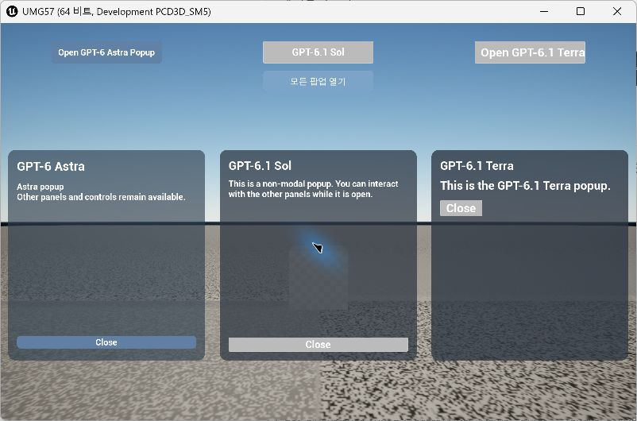
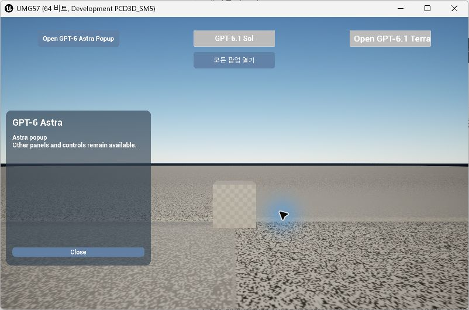
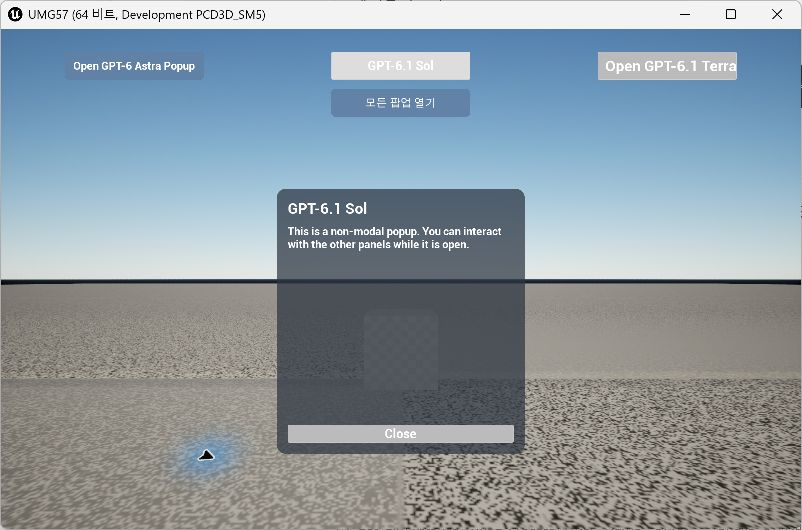
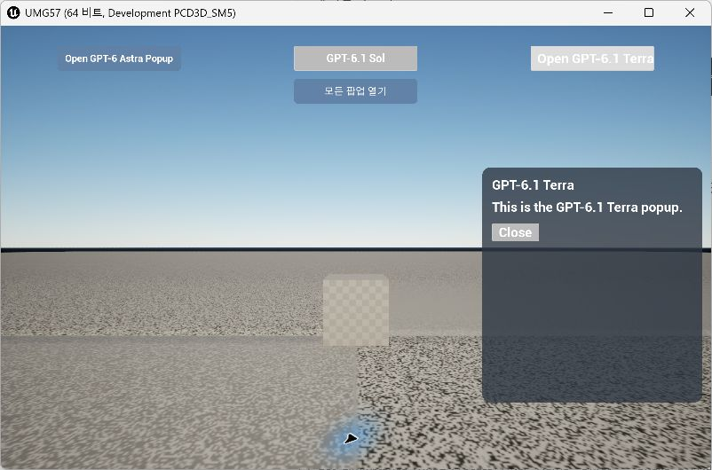

# Astra Sol Terra 팝업 구현 비교 분석 보고서

작성일: 2026-11-08, 한국 시간. 분석 대상: `7c231a09c1ddbc4f0db8d3fbbef0aa99fedeb6bd`의 비모달 팝업 구현. 엔진: UE 5.7.4, Windows Development 에디터 기반 게임 실행.

세 구현은 **3분할 배치, 비모달 입력, 제목·본문·닫기, 블러·반투명·코너 라운딩**이라는 공통 요구를 충족한다. 차이는 기본 기능의 성공 여부보다 시각적 마감, 상태 관리 방식, 에셋 생성기의 방어 처리에 있다. 이 결과물에서는 Astra가 시각적 마감, Sol이 런타임 방어 처리, Terra가 간단한 구조와 기존 에셋 부모 검증에서 각각 특징을 보인다.

## 1. 비교 범위와 판단 기준

| 항목 | 조건 |
|---|---|
| 모델 | GPT-6 Astra / GPT-6.1 Sol / GPT-6.1 Terra |
| 추론 강도 | 세 작업 모두 Medium. 작업 세션 확인 및 소스 주석에 기록 |
| 화면 순서 | 왼쪽 Astra, 중앙 Sol, 오른쪽 Terra |
| 공통 디자인 조건 | Blur Strength 8, 코너 반경 20, 카드 내부 여백 24, 가로 3분할 |
| 런타임 규칙 | 위젯 클래스에서 트리를 생성하지 않음. 편집 가능한 WBP에 트리를 저장 |
| 비교 방법 | 현재 소스 검토, 저장 WBP 자동화 검사, 실제 게임 조작 및 캡처 |
| 판정 | 확인된 사실 / 코드로부터의 추론 / 미검증 영역을 구분 |

독립적인 동일 조건 벤치마크는 아니다. 기존 Terra/Sol 구현을 바탕으로 변경했고, 마스터가 공통 배치·인터페이스·검증을 지시했으며, GUID 동기화 등 발견한 문제의 해결책을 공유했다. Astra에는 공통 ‘모든 팝업 열기’와 초기 입력 모드 설정 역할도 포함된다. 따라서 코드 길이, 수정 횟수, 작업 시간만으로 모델의 일반적 능력이나 비용 효율 순위를 매기지 않는다.

평가는 **최종 통합 결과물**을 대상으로 한다. 초기 버전의 모달 포커스 유지 요구는 이후 비모달 요구로 변경됐으므로, 현재 포커스 트랩이 없는 것은 결함이 아니라 요구 반영이다.

## 2. 실제 실행 캡처

게임 창은 `-game -windowed -ResX=1600 -ResY=1000`으로 실행했다. 아래 파일은 화면 캡처 도구가 반환한 **802×530 JPEG 원본**을 그대로 저장한 것으로, 합성·크롭·색상 보정은 하지 않았다. 창 테두리와 포인터 표시가 포함된다. 런타임 해상도와 캡처 파일 픽셀 수는 다르므로 글자·반경의 정확한 픽셀 측정 자료로 사용하지 않는다.

배경은 작업 환경에 이미 저장돼 있던 조명·바닥 수정 상태다. `UMGTest.umap`과 `DefaultInput.ini`의 기존 미커밋 변경은 이번 보고서 커밋에 포함하지 않는다. UI 비교 대상은 위에 명시한 커밋이며, 깨끗한 체크아웃에서는 배경 장면이 캡처와 다를 수 있다.

### 전체 열기

세 카드의 영역과 높이는 일치한다. Astra와 Sol의 닫기는 하단의 넓은 버튼이고, Terra의 닫기는 본문 바로 아래의 작은 버튼이다. 이는 위치·채움 설정의 차이이며 공통 기능 요구의 실패는 아니다.

### Astra 단독

### Sol 단독

### Terra 단독

## 3. 기능 및 시각적 완성도 비교

| 비교 항목 | Astra | Sol | Terra |
|---|---|---|---|
| 지정 영역에서 개별 열기·닫기 | 확인 | 확인 | 확인 |
| 다른 팝업이 열린 상태에서 재열기 | 확인 | 확인 | 확인 |
| 전체 열기 연동·중복 생성 방지 | 확인 | 확인 | 확인 |
| 팝업 밖 다른 UI 조작 | 포커스 트랩 없음 | 포커스 트랩 없음 | 포커스 트랩 없음 |
| 제목·본문·닫기 구성 | 충족 | 충족 | 충족 |
| 블러 및 카드 반경 | 8 / 20 | 8 / 20 | 8 / 20 |
| 카드 브러시 알파 | 0.62 | 0.72 | 0.78 |
| 제목 / 본문 폰트 크기 설정 | 26 / 18 | 24 / 18 | 제목 24, 본문 기본값 사용 |
| 제목 자동 줄바꿈 | 명시적으로 활성화 | 텍스트 헬퍼에서 활성화 | 명시 설정 없음 |
| 닫기 배치 | 본문 Fill, 하단 전체 폭 | 본문 Fill, 하단 전체 폭 | 본문 다음, 왼쪽 정렬 |
| 버튼 스타일 | Normal/Hovered/Pressed 색상, 반경 10 | 기본 스타일 | 기본 스타일 |

알파 값은 소스의 브러시 색상 값이며 최종 화면의 측정 투명도가 아니다. 블러 강도가 동일해도 뒤에 놓인 장면, 색상, 알파 때문에 체감 효과가 달라진다. 특히 중앙 Sol 뒤에는 큐브가 있어 다른 두 영역과 블러 선명도를 공정하게 비교할 수 없다.

**시각적 판단:** Astra는 카드와 버튼 색상이 연결되고 글자 크기 위계가 명시돼 있어 세 결과 중 스타일 작업의 범위가 가장 넓다. Sol은 제목·본문 크기와 하단 닫기 배치가 정돈돼 있으나 버튼은 기본 외형이다. Terra는 기능 구분이 명확하지만 본문이 상대적으로 크게 보이고, 카드 하단에 넓은 빈 공간이 남는다. 제품 수준의 일관성이 목표라면 Terra의 본문 크기와 닫기 배치를 먼저 정리할 만하다.

## 4. 런타임 구조와 유지보수성

| 항목 | Astra | Sol | Terra |
|---|---|---|---|
| 팝업 클래스 지정 | WBP 기본값의 `TSubclassOf<UPopupWidget_GPT6Astra>` | 고정 에셋 경로 `LoadClass` | 고정 에셋 경로 `LoadClass` |
| 중복 열기 조건 | `ActivePopup` 존재 여부 | `IsValid`와 `IsInViewport` | 포인터 존재와 `IsInViewport` |
| 닫기 상태 전달 | `OnClosed` 델리게이트로 메인의 참조를 즉시 비움 | 닫을 때 화면에서 제거, 다음 열기에서 상태 재확인 | 닫을 때 화면에서 제거, 다음 열기에서 상태 재확인 |
| 종료 처리 | 델리게이트 해제, 팝업 제거, 버튼 이벤트 해제 | 팝업 유효성 및 버튼 null 검사 후 정리 | 팝업 존재 검사 및 버튼 이벤트 해제 |
| 루트 클릭 통과 | UUserWidget 기본값과 저장 Canvas 설정에 의존 | NativeConstruct에서도 명시 | NativeConstruct에서도 명시 |
| 팝업의 입력 모드 변경 / Tick 포커스 보정 | 없음 | 없음 | 없음 |

### Astra

**강점:** 팝업 클래스가 편집 가능한 속성이고 타입이 구체적이다. 닫힘을 이벤트로 전달하므로 정상 닫기 후 상태가 즉시 정리된다. 버튼 스타일 헬퍼가 있어 세 상태의 색상과 라운딩을 함께 관리한다.

**개선점:** `OpenAllPopups()`가 Sol/Terra의 구체 클래스에 직접 의존하고 `GetAllWidgetsOfClass`로 찾는다. 세 모델 데모에는 충분하지만 모델 수가 늘면 공통 대시보드나 인터페이스로 분리하는 편이 낫다. 초기 `GameAndUI` 설정도 Astra 메인에 있어 공통 실행 흐름이 특정 모델에 결합돼 있다.

**코드상 잠재 경계 사례:** 다른 코드가 Astra 팝업에 직접 `RemoveFromParent()`를 호출하면 `OnClosed` 경로를 거치지 않아 메인의 `ActivePopup`이 남는다. 이후 `OpenPopup()`의 존재 검사 때문에 재열기가 차단될 수 있다. 이는 코드로 추론한 결과이며 이번 실제 플레이에서는 외부 제거를 실행하지 않았다. 사용자가 닫기 버튼으로 닫는 정상 경로는 확인했다.

### Sol

**강점:** 중복 검사에 `IsValid`와 뷰포트 포함 여부를 함께 사용한다. 제거된 위젯을 다음 열기에서 새로 만들 수 있고, Destruct의 버튼 null 검사도 포함한다. 본문 Fill 배치와 공통 텍스트 헬퍼 덕분에 제목·본문·닫기 구성이 읽기 쉽다.

**개선점:** 에셋 경로가 코드에 고정돼 있어 이름이나 폴더 변경을 코드 수정으로 따라가야 한다. 닫힌 위젯 참조는 다음 열기 또는 메인 제거까지 유지된다. 반복 열기마다 참조를 교체하므로 누적 누수라고 단정할 수는 없지만 즉시 해제되는 구조는 아니다. 버튼 시각 스타일은 기본값에 머문다.

### Terra

**강점:** 열기·닫기·중복 방지 흐름이 짧고 직접적이다. 명시적인 `SelfHitTestInvisible` 설정으로 전체 화면 루트가 다른 UI를 막지 않도록 의도를 드러낸다. 에디터 생성기는 기존 WBP 부모 클래스가 예상 타입인지 확인하고 다르면 중단한다.

**개선점:** 고정 에셋 경로와 닫힌 참조 유지 특성은 Sol과 같다. Sol에 비해 런타임 정리의 유효성·null 방어가 적다. 다만 버튼은 `BindWidget` 필수 항목이므로 이를 정상 에셋에서 즉시 발생하는 오류로 평가하지 않는다. 시각적으로는 본문 폰트 명시, 제목 줄바꿈, 하단 버튼 정렬을 보완할 여지가 크다.

## 5. 에디터 에셋 작성과 검증 수준

| 항목 | Astra | Sol | Terra |
|---|---|---|---|
| 신규 트리 생성 방식 | 이전 트리를 transient로 이동한 후 교체 | 새 WidgetTree로 교체 | 기존 트리의 위젯을 transient로 이동하고 재구성 |
| 기존 에셋이 없을 때 | 실패 반환 | Factory로 신규 생성하는 경로 존재 | 실패 반환 |
| 기존 부모 타입 검사 | 명시 검사 없음 | 기존 부모는 유지하나 기대 타입 검사 없음 | 기대 부모와 일치하는지 검사 |
| GUID 동기화 | 현재 이름 추가·기존 GUID 유지·삭제 이름 제거 | 동일 | 동일 |
| 최종 저장 실행 | 정상 종료 | 정상 종료 | 정상 종료 |

세 생성기는 모두 **에셋 제작 도구**이며 기존 트리를 다시 작성한다. 디자이너가 WBP에서 수동 편집한 뒤 생성기를 재실행하면 그 배치가 대체될 수 있다. 또한 현재 GUID 정리는 애니메이션이 없는 데모를 전제로 한다. 애니메이션이나 추가 바인딩이 있는 일반 WBP 편집 도구로 그대로 확장해서는 안 된다. Sol의 신규 생성 분기는 소스에서 확인한 기능이며 깨끗한 프로젝트에서의 최초 생성 성공까지 이번 보고서에서 검증한 것은 아니다.

통합 과정에서 Terra 실행이 위젯 GUID 불일치를 드러냈고, 수정 방법을 세 생성기에 공통 적용했다. 따라서 이 부분을 특정 모델의 단독 성과나 독립적인 실력 차이로 해석하지 않는다. 최종 생성 결과는 세 모델 모두 오류·경고 없는 종료를 확인했다. C++ 빌드는 성공했지만 기존 툴체인 권고·include-order 경고와 Sol 생성기의 로컬 변수 이름 가림 경고는 남아 있다.

### 확인한 증거와 한계

보고서 작성 시 `Automation RunTests UMG57.`를 재실행했다. `UMG57.Models.NonModalPanels` **1개 테스트가 성공하고 종료 코드 0**을 반환했다. 한 테스트가 세 모델을 순회한다. [검증 기록 발췌](model-popup-comparison-evidence.txt)에 결과를 보관했다.

- 자동 검사: 모델별 앵커·버튼 위치, 전체 열기 버튼 존재, 제목·본문·닫기 타입, 전체 화면 Backdrop 부재, 루트 클릭 통과 속성, 블러 강도·반경, 카드 브러시·알파, 위젯 GUID 등록.
- 실제 조작: 세 팝업 동시 열기, 반복 전체 열기 후 각 팝업 한 번씩 닫아 중복 없음 확인, 다른 팝업을 유지한 채 모델별 닫기·재열기, 상단 버튼과 Tab 탐색. 보고서 캡처 세션에서도 전체 열기와 모델별 단독 열기·닫기를 수행했다.
- 자동 검사로 보장하지 않는 부분: 실제 입력 이벤트 전달, 생성 개수의 런타임 단언, 외부 코드에 의한 제거, 해상도·DPI별 텍스트 넘침, 게임패드·스크린리더, 패키징 빌드, GPU 비용.

현재 자동 테스트는 저장된 속성을 확인하는 구조 검사다. 이름에 NonModal이 들어가더라도 런타임 입력 경로 전체를 자동 검증하는 것은 아니다. 화면에서 다른 UI를 조작할 수 있음은 확인했지만, 모든 게임 플레이 입력 매핑이 보장된다는 의미도 아니다.

## 6. 종합 판단과 개선 우선순위

**현재 수준은 세 모델 모두 요구 기능을 갖춘 비교 데모다.** 시각적 마감만 보면 Astra가 가장 많은 스타일을 적용했고, Sol은 균형 잡힌 배치와 상대적으로 많은 런타임 방어 처리를 갖췄다. Terra는 가장 단순한 흐름과 엄격한 기존 부모 검사를 제공하지만 화면 마감의 추가 여지가 크다. Astra의 공통 통합 역할이 더 크므로 이를 독립 팝업 구현 우위와 동일시하지 않는다.

1. **공통 수명 관리부터 정리:** 외부 제거·레벨 전환·메인 제거 시 재열기와 참조 해제를 자동화 테스트로 보장한다. 특히 Astra의 외부 제거 후 참조 상태를 먼저 보완한다.
2. **통합 코드를 분리:** 전체 열기와 초기 입력 모드를 Astra에서 공통 대시보드로 옮기고, 모델별 메인은 동일한 열기 인터페이스만 제공하도록 한다.
3. **디자인 기준을 통일:** 본문 크기, 버튼 최소 높이, 하단 정렬, 버튼 상태 스타일을 맞춘다. 현재 서로 다른 스타일을 비교하려는 목적이라면 이 차이는 의도적으로 유지할 수 있다.
4. **작은 창과 긴 본문을 검증:** 현재 팝업은 비율 높이와 고정 여백을 조합하며 ScrollBox가 없다. 긴 번역문·작은 창에서 넘침이 생길 가능성을 별도로 시험한다.
5. **제품 환경 검증:** 패키징된 실행 파일, 저사양 블러 대체, 키보드 포커스 표시, 접근성, GPU 프로파일링을 추가한다. 현재 자료로 성능 우열을 주장할 수는 없다.

## 소스 근거

- Astra: [MainWidget](../../UMG57/Source/UMG57/Astra/MainWidget_GPT6Astra.cpp), [PopupWidget](../../UMG57/Source/UMG57/Astra/PopupWidget_GPT6Astra.cpp), [에셋 생성기](../../UMG57/Source/UMG57Editor/GenerateAstraPanelAssets.cpp)
- Sol: [MainWidget](../../UMG57/Source/UMG57/Sol/MainWidget_GPT61Sol.cpp), [PopupWidget](../../UMG57/Source/UMG57/Sol/PopupWidget_GPT61Sol.cpp), [에셋 생성기](../../UMG57/Source/UMG57Editor/GenerateSolPanelAssets.cpp)
- Terra: [MainWidget](../../UMG57/Source/UMG57/Terra/MainWidget_GPT61Terra.cpp), [PopupWidget](../../UMG57/Source/UMG57/Terra/PopupWidget_GPT61Terra.cpp), [에셋 생성기](../../UMG57/Source/UMG57Editor/GenerateTerraPanelAssets.cpp)
- 공통: [게임 모드](../../UMG57/Source/UMG57/TestGameMode.cpp), [자동화 테스트](../../UMG57/Source/UMG57Editor/AstraModalTests.cpp), [통합 작업 기록](../superpowers/plans/2026-11-08-model-panels.md)
