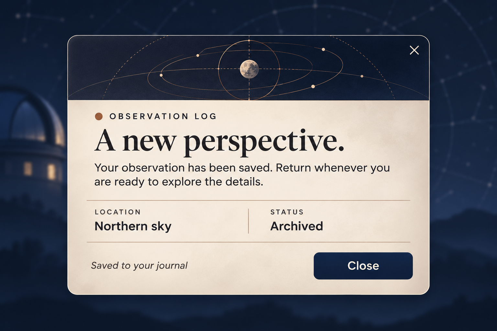
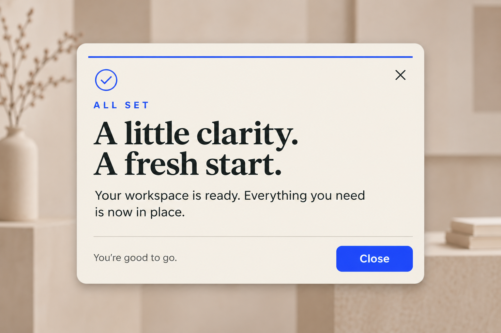
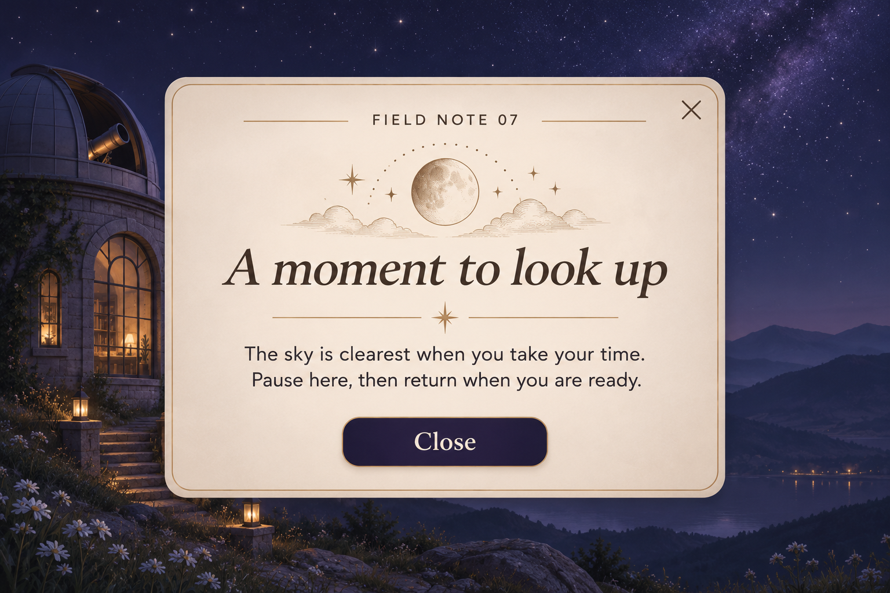
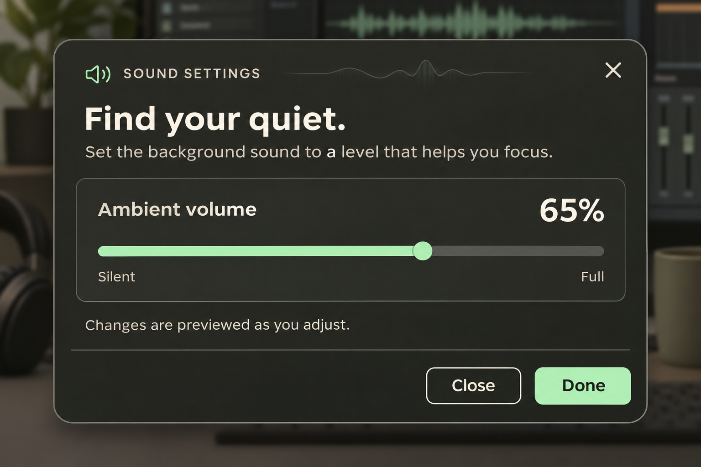
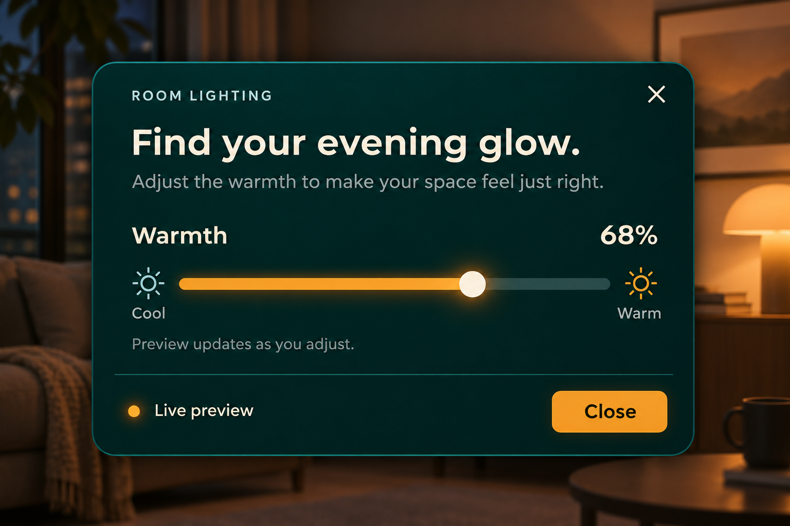
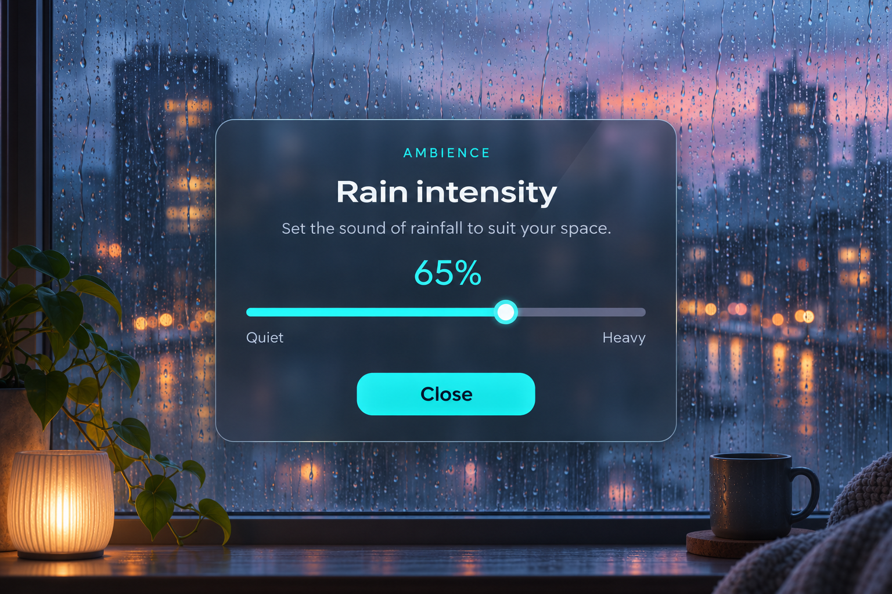

# 모델별 팝업 디자인 이미지 비교

작성일: 2026-11-08, 한국 시간. 대상은 Astra·Sol·Terra 대화에서 각각 설계한 **자유 팝업 1장과 수평 슬라이더 팝업 1장**, 총 6장의 생성 이미지다. 실제 UE 구현 비교는 [별도 보고서](model-popup-comparison.md)에 있다.

이번 결과에서는 **Astra는 정보를 구획하는 편집 디자인, Sol은 강조색과 일관된 조작 계층, Terra는 장면과 연결되는 분위기 및 간결한 구성을 강점으로 보인다.** 수평 슬라이더 시안은 세 모델 모두 조절 대상·현재 값·트랙·thumb·닫기를 알아볼 수 있게 표현했다. 용도에 따라 장점이 달라 단일 종합 점수 대신 결과물의 특징과 개선점을 비교한다.

## 비교 조건과 해석 범위

- 프롬프트 설계: GPT-6 Astra, GPT-6.1 Sol, GPT-6.1 Terra. 각 작업의 추론 강도는 Medium으로 기록했다.
- 생성 방식: 세 대화 모두 내장 `image_gen` 사용. **실제 이미지 생성 모델 식별자는 도구에서 공개되지 않았다.** 파일의 Astra/Sol/Terra 구분은 프롬프트와 디자인 방향을 설계한 대화를 의미한다.
- 공통 최소 조건: 제목·본문·닫기 버튼. 추가 과제는 수평 슬라이더의 트랙·채움·thumb·현재 값이 식별될 것. 구체 기능과 스타일은 각 대화가 선택했다.
- 모든 최종 이미지: 1536×1024 PNG. 원본과 실제 프롬프트·검수 기록을 함께 저장했으며 이미지 합성·수작업 후처리는 하지 않았다.
- 대화별 기존 맥락이 다르고 자유 주제·문구·프롬프트 길이도 다르다. 고정 프롬프트·고정 시드·반복 표본으로 실시한 통제 실험이 아니다. 평가자도 Astra 마스터이므로 아래 평가는 블라인드 평가가 아닌 근거를 공개한 시각 검토다.
- 이 이미지는 동작하는 위젯이 아니다. 그림에 적힌 Live preview나 Done은 동작 검증이 아니며, 가독성 판단도 실제 접근성 대비율 측정을 대신하지 않는다.

## 1. 자유 팝업 시안

### Astra — Observation Journal

[원본 PNG](../../design/popup-concepts/Astra/observation-journal.png) · [프롬프트와 검수 기록](../../design/popup-concepts/Astra/observation-journal.md)

남색 궤도 도식과 아이보리 본문을 구분하고, 제목·설명·위치/상태·닫기 순으로 정보를 배치했다. 여러 정보 항목을 가진 완료 알림에 적합한 구성이다. 메타데이터 행의 구분선과 정렬이 읽는 순서를 분명하게 만든다.

반면 제목과 도식 헤더가 크게 표현돼 단순 알림으로는 시각적 무게가 크다. 프롬프트의 ‘좁은 헤더’보다 헤더가 높고, 반투명 유리보다는 종이 표면의 인상이 강하다. 이 차이는 디자인 의도와 실제 생성 결과의 차이로 기록한다.

### Sol — Quiet Signal

[원본 PNG](../../design/popup-concepts/Sol/quiet-signal-v1.png) · [실제 프롬프트](../../design/popup-concepts/Sol/quiet-signal-v1-prompt.txt) · [검수 기록](../../design/popup-concepts/Sol/quiet-signal-v1-metadata.txt)

코발트 선·체크 아이콘·상태 문구·닫기 버튼이 같은 색으로 연결된다. 왼쪽 정렬의 큰 제목과 오른쪽 하단 버튼은 익숙한 알림 흐름을 제공한다. 필수 요소 외에 장식이 비교적 적어 일반 도구의 완료 알림으로 옮기기 쉽다.

제목 두 줄의 비중이 커서 실제 작은 창에서는 크기 조절이 필요하다. 생성 결과의 카드가 프롬프트에 적은 약 760×520보다 크게 보이며, 추상적인 작업 배경 대신 화병과 책이 있는 실내 배경이 나타났다. 정확한 픽셀 배치는 이미지 생성만으로 보장되지 않았다.

### Terra — The Quiet Observatory

[원본 PNG](../../design/popup-concepts/Terra/quiet-observatory.png) · [프롬프트와 검수 기록](../../design/popup-concepts/Terra/quiet-observatory.md)

관측소 야경과 황동색 달 장식, 중앙 정렬의 세리프 제목이 하나의 분위기를 만든다. 탐험 게임의 발견 알림이나 휴식 안내처럼 감정을 전달하는 용도에 잘 맞는다. 닫기 버튼도 중앙에 있어 단일 행동이 분명하다.

배경 장면의 세부 묘사와 장식이 가장 많고, 달 그림과 구분선이 본문보다 많은 면적을 차지한다. 반복적으로 읽는 설정·업무 알림보다는 장면 연출에 적합하다. 짧은 본문에는 중앙 정렬이 잘 맞지만 긴 문장이나 여러 항목에는 다른 정렬 방식이 필요하다.

### 자유 디자인 비교

| 관찰 항목 | Astra | Sol | Terra |
|---|---|---|---|
| 핵심 기능 | 관측 기록 저장 완료 | 작업 공간 준비 완료 | 관측 중 잠시 멈춤 안내 |
| 정보 구조 | 헤더·본문·메타데이터·푸터 구획 | 체크·상태·제목·본문·푸터 | 장식·제목·본문·중앙 행동 |
| 시각적 강점 | 여러 정보의 정렬과 구획 | 강조색의 일관성과 명확한 CTA | 배경과 카드의 분위기 연결 |
| 가장 큰 개선점 | 헤더·제목 규모 축소 | 작은 창에서 제목 비중 조절 | 장식 밀도와 배경 집중도 조절 |
| 어울리는 사용처 | 상세 결과·기록 알림 | 일반 완료 알림 | 탐험·스토리·휴식 안내 |

Astra와 Terra는 서로의 이미지를 참조하도록 지시받지 않았지만 모두 관측소·아이보리·세리프 방향을 선택했다. 이는 이번 출력의 스타일 수렴이며 복제나 일반적인 창의성 우열의 증거는 아니다. 세 자유안 모두 세리프 제목과 밝은 카드를 사용했으므로 이 세 장만으로 스타일 다양성이 충분히 평가됐다고 볼 수도 없다.

## 2. 수평 슬라이더 팝업 시안

### Astra — Ambient Volume

[원본 PNG](../../design/popup-concepts/Astra/ambient-volume-slider.png) · [프롬프트와 검수 기록](../../design/popup-concepts/Astra/ambient-volume-slider.md)

조절 영역을 별도 테두리로 묶고 `Ambient volume`, `65%`, `Silent / Full`을 연결했다. 민트색 채움과 원형 thumb, 남은 회색 트랙이 잘 구분된다. 일반 시안의 밝은 편집 스타일에서 어두운 오디오 설정 화면으로 바뀌어 기능 차이를 표현한다.

강점은 조절 대상과 현재 값을 같은 행에 두고, 슬라이더와 도움말을 분리한 점이다. 다만 `Close`와 `Done`, 실시간 미리보기 문구를 동시에 사용하므로 실제 구현에서는 Close가 변경을 취소하는지 유지하는지 정의해야 한다. 카드가 화면 대부분을 차지해 작은 보조 팝업보다는 설정 패널에 가깝다.

### Sol — Afterglow

[원본 PNG](../../design/popup-concepts/Sol/afterglow-slider-v1.png) · [실제 프롬프트](../../design/popup-concepts/Sol/afterglow-slider-v1-prompt.txt) · [검수 기록](../../design/popup-concepts/Sol/afterglow-slider-v1-metadata.txt)

실내 조명의 따뜻함을 `68%`로 조절하는 시안이다. 차가운 색과 따뜻한 색의 태양 아이콘, `Cool / Warm` 문구, 호박색 채움이 방향을 반복해서 알려 준다. 밝은 thumb가 채워진 트랙과 구별되고, 하단의 `Live preview`는 결과 확인 방식을 설명한다.

시각적 의미와 조절 방향의 연결이 가장 구체적이다. 다만 따뜻함의 퍼센트는 상대 척도이므로 실제 조명 기능에서는 색온도 단위 또는 범위 설명을 검토해야 한다. 본문·미리보기 문구는 제목보다 대비가 약하며, thumb의 광택 효과는 축소 화면에서 확인할 필요가 있다.

### Terra — Rain Room

[원본 PNG](../../design/popup-concepts/Terra/rain-room-slider.png) · [프롬프트와 검수 기록](../../design/popup-concepts/Terra/rain-room-slider.md)

비 오는 창문과 청록색 슬라이더로 빗소리 강도 조절 기능을 즉시 연상시킨다. 중앙의 `65%`와 넓은 Close 버튼을 사용해 동작 수를 줄였으며, 세 슬라이더 시안 중 카드가 화면에서 차지하는 비율이 상대적으로 작다.

간결한 단일 설정에 적합하고 유리 표면 느낌이 뚜렷하다. 반면 창문의 빗방울·도시 불빛·책상 소품이 많아 주변 시각 자극이 크다. `Quiet / Heavy`는 조용함과 비의 강도를 섞은 표현이므로, 실제 제어 대상이 음량인지 비의 밀도인지에 따라 용어를 통일하는 편이 좋다. 미리보기 또는 변경 저장 시점도 이미지에는 명시되지 않았다.

### 슬라이더 비교

| 관찰 항목 | Astra | Sol | Terra |
|---|---|---|---|
| 조절 대상 | 주변 소리 음량 | 실내 조명 따뜻함 | 빗소리 강도 |
| 표시값 | 65% | 68% | 65% |
| 양 끝 문구 | Silent / Full | Cool / Warm | Quiet / Heavy |
| 트랙·채움·thumb 식별 | 명확 | 명확 | 명확 |
| 현재 값 배치 | 조절 라벨 오른쪽 | 조절 라벨 오른쪽 | 제목 아래 중앙 |
| 조작 결과 안내 | 조절 중 미리보기 문구 | 미리보기 문구와 상태 표시 | 별도 안내 없음 |
| 하단 행동 | Close + Done | Close | Close |
| 가장 설득력 있는 점 | 설정 영역의 구획 | 색·아이콘·방향의 의미 일치 | 기능과 장면의 직관적인 연결 |
| 우선 보완점 | Close/Done 저장 의미 | 단위·보조 문구 대비 | 강도/음량 용어와 적용 시점 |

세 이미지의 thumb는 표시값에 가까운 위치로 보이나, 픽셀 단위 정확도나 수치 매핑을 검증한 것은 아니다. 정지 이미지에서는 드래그, 키보드 화살표, 포커스 표시, 최소·최대 범위, 스텝, 비활성 상태, 실제 음량·조명 변화가 구현되지 않는다.

## 3. 종합 평가와 구현 시 고려사항

**기능 설명의 명확성**을 우선하면 Sol의 슬라이더안이 방향을 색·아이콘·문구로 함께 설명한다. **여러 정보를 정리하는 구조**를 우선하면 Astra의 구획 방식이 유용하다. **장면과 감정의 일치 및 간결한 단일 조작**을 우선하면 Terra의 빗소리안이 강점을 보인다. 이는 이 여섯 결과물에 대한 판단이며 모델 자체의 포괄적인 디자인 순위는 아니다.

실제 UMG로 구현할 때는 배경과 장식 그림만 필요한 텍스처로 사용하고, 텍스트·버튼·슬라이더는 편집 가능한 UMG 요소로 재구성하는 것이 적절하다. 완성 이미지를 그대로 한 장의 버튼으로 사용하는 것은 시각 시안을 재현할 뿐, 조절 가능한 UI를 구현한 것이 아니다. 텍스트 대비, 다양한 창 크기, 한글 번역, 실제 터치/마우스 영역과 키보드 조작은 별도 검증해야 한다.

이번 작업에서는 이미지와 문서만 추가했으며 UE 팝업 기능 코드를 수정하지 않았다. 사용자가 별도로 지정한 기존 `UMG57/Config/DefaultInput.ini`와 `UMG57/Content/Maps/UMGTest.umap`도 최종 통합 커밋에 함께 포함한다. 두 파일은 이 디자인 이미지 실험에서 생성한 결과물이 아니다.

## 저장 및 검증

- 원본과 프롬프트: [design/popup-concepts](../../design/popup-concepts)
- PNG 실제 크기·SHA-256: [파일 검증 기록](popup-design-concepts-manifest.json)
- 총 6장 모두 실제 파일을 열어 제목·본문·닫기와 추가안의 수평 슬라이더를 확인했다. 평가를 위해 기존 시안을 덮어쓰거나 여러 후보 중 선별해 숨기지 않았다.
